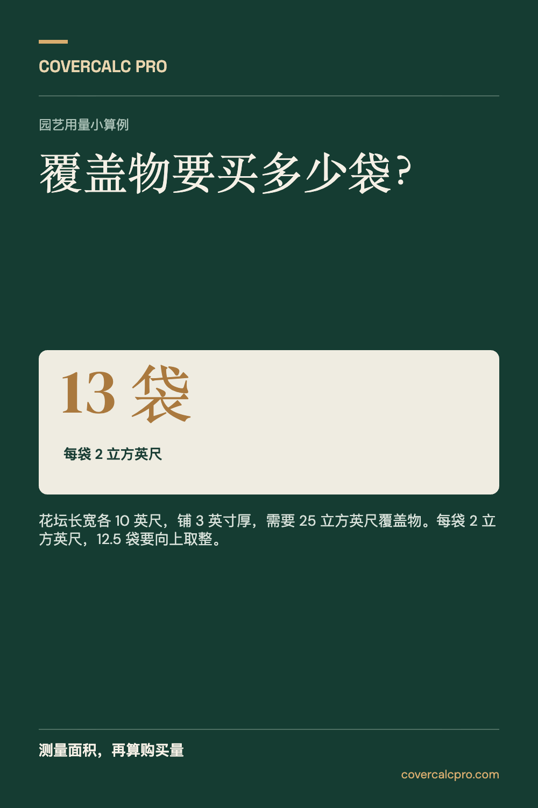
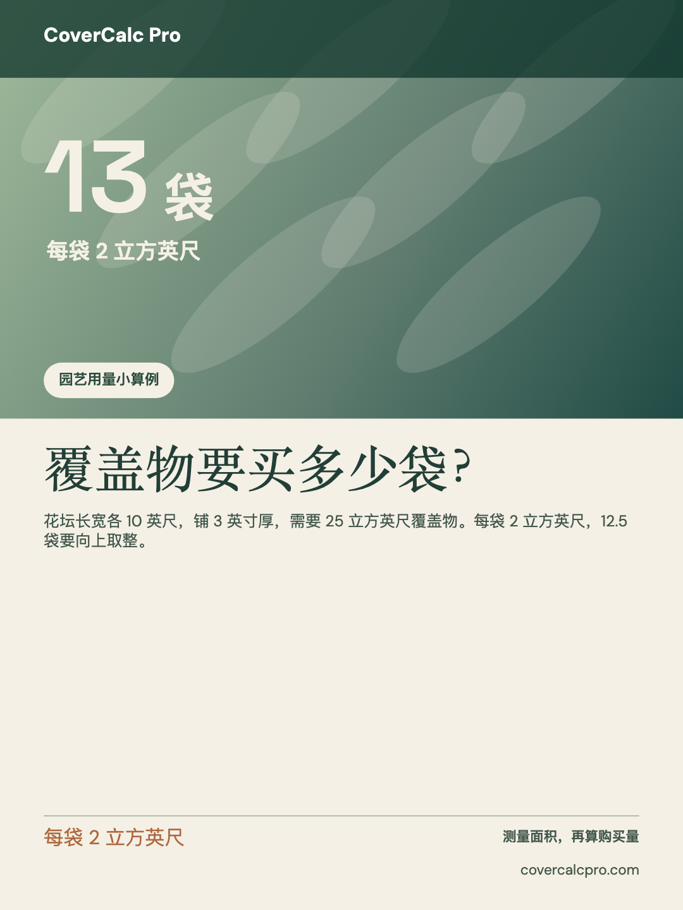
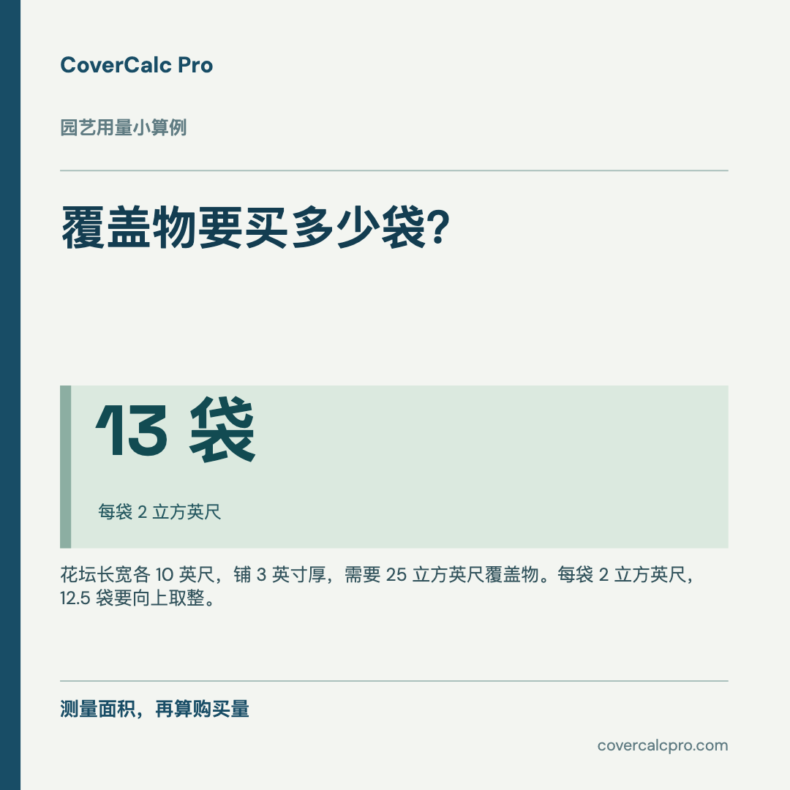
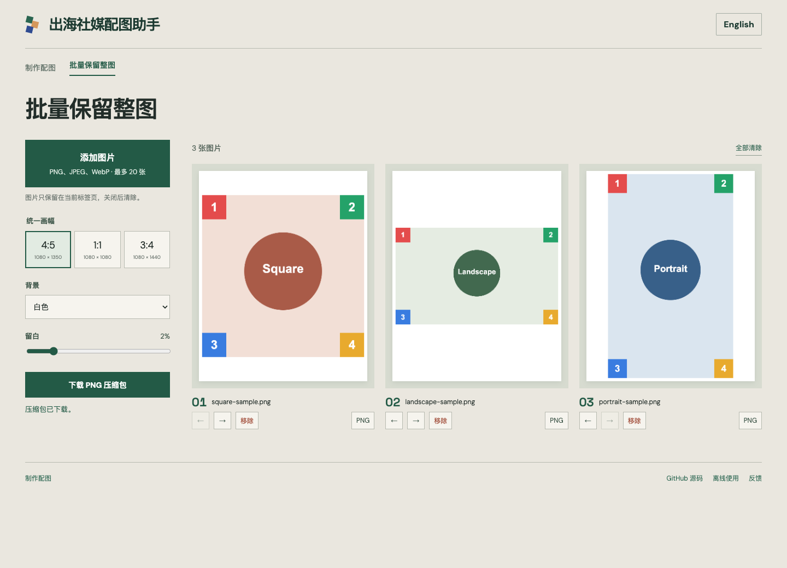

# 出海社媒配图助手（Social Post Image Maker）

**一份内容，分别做好 Pinterest、Instagram、Lemon8、Facebook 的配图。**

面向要在海外平台发图的中文创作者：用中文操作，填写自己的中文或英文内容，然后分别导出适合 Pinterest、Instagram、Lemon8、Facebook 的图片。每个平台重新排版，不把同一张图裁成四份。产品英文名是 Social Post Image Maker；仓库地址沿用早期代号 `aspectory`，避免已分享的体验链接失效。

**[打开中文版](https://lydiatools.github.io/aspectory/zh.html?utm_source=github&utm_medium=referral&utm_campaign=aspectory_readme_zh&utm_content=top)** · [下载当前 main 分支源代码 ZIP](https://github.com/LydiaTools/aspectory/archive/refs/heads/main.zip) · [English README](README.md)

**横图、方图和竖图要一起发？** [打开「批量保留整图」](https://lydiatools.github.io/aspectory/carousel.html?lang=zh)，把整批图片放进同一画幅，调整顺序后下载编号 PNG 压缩包。[单文件离线版](https://github.com/LydiaTools/aspectory/releases/download/v0.2.0/carousel-offline.html)下载后双击即可使用。

已收录于 [Social Media Hacker List · 多平台工具清单](https://github.com/MobileFirstLLC/social-media-hacker-list#multi-platform)。

   

## 功能

- 批量保留整图：最多添加 20 张横图、方图或竖图，统一放进 4:5、1:1 或 3:4 画幅。可选白色、黑色或图片模糊背景，调整留白与顺序，下载单张 PNG 或按顺序编号的整批 ZIP。中英文界面，无需账号、不上传图片。
- 四种风格：田野笔记、照片叙事、数据手册、醒目海报。
- 四种画布：Pinterest 1000×1500、Instagram 1080×1350、Lemon8 1080×1440、Facebook 1080×1080。
- 实时预览，单张下载 PNG/JPEG，或把四个平台分别排版的 PNG 一次打包下载为 ZIP。
- 可上传自己的照片；不上传到服务器。没有照片时，用明显是图形的背景突出所填的关键数字。
- 中英文界面；切换界面语言不会覆盖正在编辑的文案。
- 中文浏览器首次打开默认中文界面和中文示例；分享 [`zh.html`](https://lydiatools.github.io/aspectory/zh.html) 链接可让接收者直接看到中文标题、操作界面和中文分享卡片。中文界面可直接输入英文，制作面向海外读者的配图；工具不会自动翻译。切换语言只转换未修改的示例，不会翻译或覆盖你自己写的内容。
- 无需账号、API Key 或后端；草稿只保存在当前浏览器的本地存储。
- 在线 GitHub Pages 演示页只在你明确同意后加载 Google Analytics，用于基础访问、来源及前往 LydiaTools GitHub 页面的点击统计；自动增强测量（滚动和通用出站点击）已关闭。统计代码不发送编辑器文案或图片，本地构建不会加载 Google Analytics。

## 上手

### 批量保留整图

1. 打开[中文版图片工作台](https://lydiatools.github.io/aspectory/carousel.html?lang=zh)，或下载并双击 [`carousel-offline.html`](https://github.com/LydiaTools/aspectory/releases/download/v0.2.0/carousel-offline.html)。
2. 添加自己的图片，或[下载三张 CC0 练习照片](https://lydiatools.github.io/aspectory/examples/carousel-photo-sources.zip)并解压。这组横图、方图与竖图可用「4:5」「白色」「2%」试用；「试用示例图片」提供四角带编号的测试插画。
3. 用箭头调整顺序，点击「下载 PNG 压缩包」。文件按当前顺序编号。



上图仍使用工具生成的三张原创测试插画，四角编号用于核对是否完整。另备的下载练习包包含 freestocks.org、Cecelia Alexander 和 Tyler C. 的三张 CC0 摄影作品；见[照片来源与试用步骤](public/examples/carousel-photos/CREDITS.md)。[截图来源记录](docs/screenshots/PROVENANCE.md)

支持 PNG、JPEG、WebP，单张不超过 15 MB／4800 万像素，最多 20 张。处理时先将长边缩至最多 2048 像素，再完整缩放到所选的 1080 像素宽画幅；这是重新采样后的配图，不是原像素无损复制。透明区域叠加到所选背景。图片只在当前标签页内存中，关闭即清除。暂不支持视频、HEIC 和动态导出。统一画幅是发布前准备，发布时仍需核对平台自己的预览。

### 制作内容配图

在线打开 [出海社媒配图助手中文版](https://lydiatools.github.io/aspectory/zh.html?utm_source=github&utm_medium=referral&utm_campaign=aspectory_readme_zh&utm_content=quick_start)，把示例内容换成自己的真实资料，选择风格和平台，检查预览后下载单张图片，或点击「四平台 PNG 打包下载」。如果面向英语读者，就在中文界面里填写英文内容。发布前请在目标平台再次查看实际裁切效果。

用过之后，欢迎通过[中英文反馈表](https://github.com/LydiaTools/aspectory/issues/new?template=use-feedback.yml)说说你做的是哪个平台、用了什么版式，以及哪里不好用。提交需要登录 GitHub；无需公开自己的私有文案。

```bash
git clone https://github.com/LydiaTools/aspectory.git
cd aspectory
npm install
npm run dev
```

构建与测试：`npm run build`、`npm test`。

构建同时生成 `dist/carousel-offline.html`，把批量整图模式的脚本、样式、字体及许可证打包为一个 HTML 文件。本地离线版的图片处理不发起网络请求；托管在线版沿用明确同意后才启用的访问统计。

## 关于 Muse 示例图

项目附带一张作者在 Muse 工作区制作的 CoverCalc Pro 园艺信息图，用作**视觉参考**。它不是本工具的生成结果、软件截图、已发布帖子的证明或效果数据。图片和来源记录见 [`docs/examples/`](docs/examples/)。四套布局及渲染代码是为本项目独立编写的。

Lemon8 的照片叙事示例使用 CoverCalc Pro 园艺改造**概念图**，并非客户工程竣工实拍。截图来源见 [`docs/screenshots/PROVENANCE.md`](docs/screenshots/PROVENANCE.md)。

## 能力边界

当前版本是**内容排版与图片生成工具**，并非输入一句话就生成写实照片的 AI 模型；也不会自动发布、验证事实或保证流量。过长的文字可能被缩短，界面会提示；数字、配图和来源应由发布者核实。代码采用 MIT 许可证，Muse 示例图和品牌素材不自动包含在代码许可证内。

2026-10-24 验收：13 项 Node 测试与生产构建通过；本机 Chrome 156 核对了导出像素和源图四角、ZIP 顺序、无效文件、透明图、JPEG 方向、20 张上限、中英文操作及离线导出。[可复现检查步骤](docs/carousel-validation.md)。
